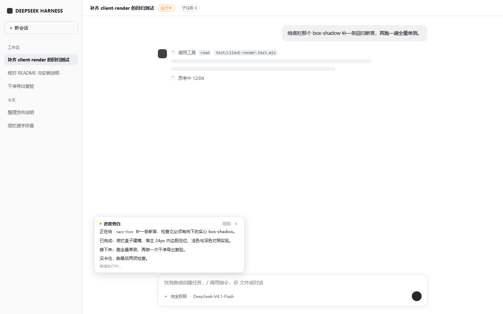
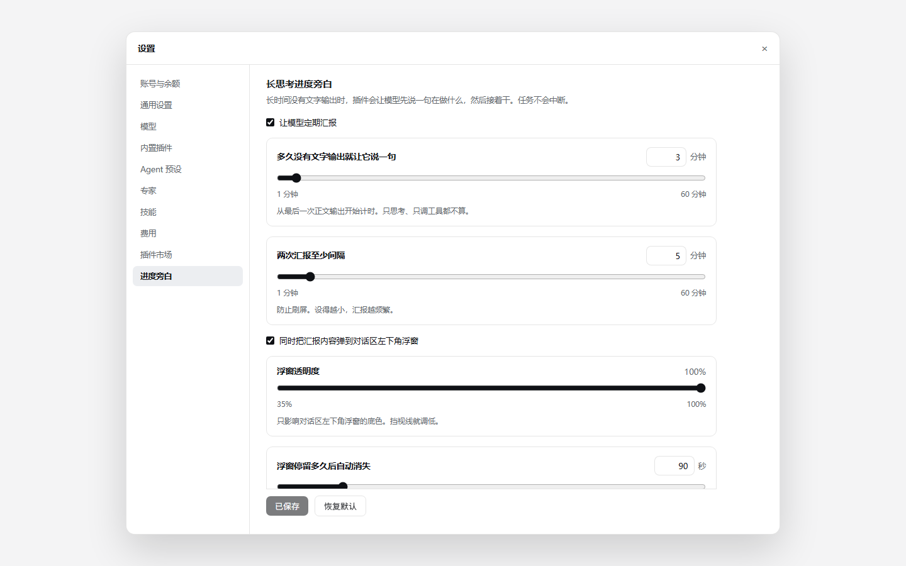
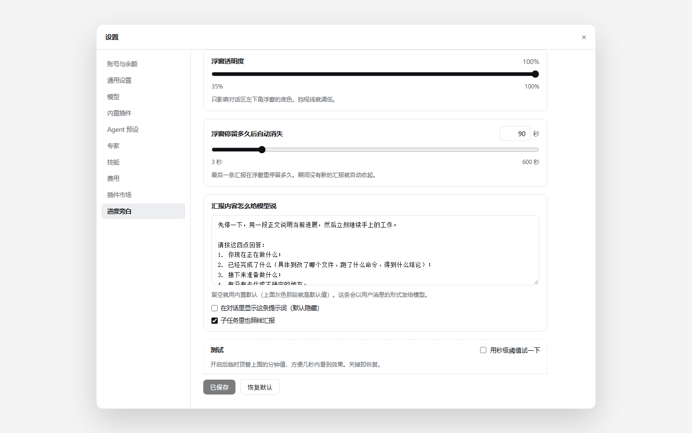
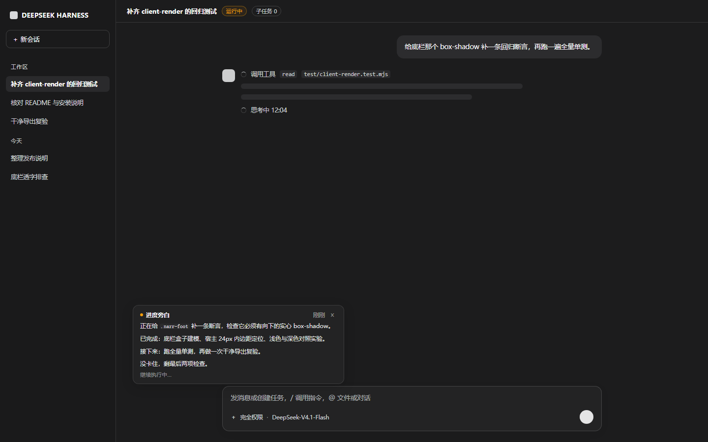

# dsh-narrator 安装与功能说明

> 模型想得太久时，先替它说一句话，然后让它接着干。

这是一个 DeepSeek Harness（下称 DSH）插件。解决一个很具体的问题：**模型长时间只思考、不出声时，界面上什么都没有，你不知道它是卡住了还是在干活。**



---

## 一、它解决的是什么问题

DSH 的代理循环里有这么一个判断（宿主源码）：

```js
if (turnEnds && decision.messages.length === 0) break;
if (turnEnds && this.inbox.nextStep.length === 0) {
  await this.dispatch.serial('agent/turn-stopping', { turn, signal });
}
if (turnEnds && this.inbox.nextStep.length === 0) break;
```

**一条不带任何工具调用的纯文本消息，会被判定为「回合结束」，任务当场停住。**

所以「先输出一句进度」和「任务别中断」在 DSH 里天然冲突——这正是为什么单纯在提示词里要求模型「中途说一句」不管用：模型真说了，回合就结束了。

这个插件用 `agent/pre-step` 绕过这个限制：在**下一个 step 的边界**往请求里多带一条消息，`decision.messages.length` 就不为 0，回合不会关。

---

## 二、机制

### 触发基准：按「多久没出文字」，不是「某一步跑了多久」

工具调用、思考都不算「文字输出」——所以模型连续调二十次工具时，静默计时照样在走。这是刻意的：**密集调工具却一句话不说，恰恰是最该提示的时候。**

### 到点之后不发生任何事情

静默超阈值时，插件只在内存里记一笔「该汇报了」。界面完全无感，会话里也不写任何东西。

真正的动作在**下一个 step 边界**：`agent/pre-step` 这个 waterfall 钩子里，往本次请求多带一条消息。宿主照样 `this.step(decision)`，回合不会关闭。

```
模型只思考、不出声
      │
      ▼
静默超过阈值（默认 60 秒）
      │
      ▼
只记一笔「该汇报了」          ← 界面上什么都还没动
      │
      ▼
下一个 step 边界：注入提示词
      │
      ▼
模型用正文说一段
      │
      ├─→ 对话区左下角浮窗显示这段原文
      └─→ 正文继续走，回合不关闭
```

为什么必须等 step 边界：模型往往正卡在两次工具调用之间。这时候往会话里塞消息，会落在 `assistant(tool_calls)` 与 `tool` 结果中间，宿主直接报错。

### 注入的消息你看不见，但模型看得到

`source: { kind: 'narrator', form: 'notice' }` 会被客户端归为 `context` 节点，`isVisibleChatNode` 把它排除在可见对话行之外。但**模型照样读得到**——请求组装只看 role。

想让用户看见提示词原文，打开设置卡里的「在对话里显示这条提示词」，`source.kind` 会换成 `user`。

### 输出什么：模型自己说的一段话

不是插件拼的模板，是模型按当下情况写的正文。插件只给四个要点：

1. 你现在正在做什么；
2. 已经完成了什么（具体到改了哪个文件、跑了什么命令、得到什么结论）；
3. 接下来准备做什么；
4. 有没有卡住或不确定的地方。

**这正是比模板强的地方**：模板只能拿到工具名和路径，模型知道自己刚才想明白了什么。

提示词可以在设置卡里整段替换。末尾的「说完必须继续执行，不要结束任务」是必要的——机制只保证回合不关闭，模型自己停下来还是会停。

### 子智能体不汇报，但主窗口会告诉你它在等

子智能体有自己的会话，界面上看不到，往它那里注入汇报纯属浪费一次模型调用。所以 `includeSubagents` 默认**关**。

但主窗口在等子智能体时，它自己的静默计时照常在走——子智能体跑得越久，主窗口越该提示。浮窗这时会说清在等什么：

| 悬空的调用 | 浮窗怎么说 |
|---|---|
| `subagent` / `workflow` / `spawn_teammate` | 正在等子任务返回 |
| `web_search` / `web_fetch` / `read_page` | 正在查外部资料 |
| `ops_bash` / `pwsh` / `pty` | 正在跑命令 |
| `ops_read` / `ops_grep` / `ops_glob` | 正在读文件 |

### 浮窗的三个阶段

静默到点后，真正的注入要等下一个 step 边界。主窗口调子代理时这个 step 可能挂着好几分钟，等它结束再亮卡，用户早就以为卡死了。所以浮窗分三段：

| 阶段 | 标题 | 正文 |
|---|---|---|
| 到点，还没到 step 边界 | **还在等** | 上一段原文（如果有）+ 一行「正在等子任务返回，已经等了 42 秒」 |
| 已注入，模型在憋那段话 | **正在整理汇报** | 同上，等待行换成「模型正在整理这次汇报」 |
| 模型开口了 | **正在汇报** | 模型的原话，替换掉整张卡 |

停 `lingerSeconds`（默认 90 秒，可设 5 秒~10 分钟）后自动消失，也可以点右上角 `×` 立刻关。按会话隔离，切走再切回来会重新出现。

## 三、安装

### 前置

- DeepSeek Harness **0.2.1 或以上**（`dsh.client` 字段与 `shell.overlay` 槽位依赖这个版本）
- Node.js **18 或以上**
- 插件零运行时依赖，不需要 `npm install`

### 步骤

**1. 解压到任意目录**，比如：

```
D:\tools\dsh-narrator\
  ├── lib/
  │   ├── index.js          后端（约 96 KB）
  │   ├── client.js         前端设置卡与浮窗（约 61 KB）
  │   └── config-store.js   配置读写
  ├── package.json
  ├── cordis.patch.yml
  ├── README.md             完整技术文档
  ├── LICENSE
  ├── test/                 测试与取证脚本
  └── notes/                开发笔记（宿主 CSS 变量清单等）
```

**2. 放进 profile 的 node_modules**

把整个目录拷到 `%USERPROFILE%\.dsh\profiles\<你的profile>\node_modules\dsh-narrator\`
（macOS/Linux 是 `~/.dsh/profiles/<profile>/node_modules/dsh-narrator/`）。

profile 名字在 DSH 设置里能看到，默认通常是 `desktop`。

**3. 改 profile 的 `package.json`**

同一个 profile 目录下的 `package.json`，加两处：

```jsonc
{
  "dependencies": {
    // ...原有内容...
    "dsh-narrator": "file:../../path/to/dsh-narrator"   // 指向上一步解压出来的目录
  },
  "dsh": {
    "profile": {
      "bundles": [
        // ...原有内容...
        "dsh-narrator"          // 加在数组末尾
      ]
    }
  }
}
```

> ⚠️ **两个地方都要加。** 只加 `bundles` 而不加 `dependencies`，pnpm 重装时可能把它清掉；只加 `dependencies` 而不加 `bundles`，插件不会被加载。改完 `package.json` 之后**启动 DSH 时如果它自动跑了一次 pnpm install，要回头复查 `bundles` 数组还在不在**——插件管理器重写这个文件时有过把它清掉的先例。

**4. 重启 DSH**

插件在启动时加载。

**5. 验证装好了**

打开 **设置 → 进度旁白**，能看到设置卡就是成了。

也可以用命令行验（端口号看 DSH 窗口地址栏）：

```bash
curl http://127.0.0.1:<端口>/api/narrator/status
```

返回 `{"ok":true,"version":"0.12.2",...}` 即正常。这个路由只在 `127.0.0.1` 上响应，外部访问不到。

---

## 四、使用

### 设置卡（设置 → 进度旁白）



| 项目 | 说明 |
|---|---|
| 启用进度旁白 | 总开关 |
| 多久没有文字输出就汇报一次 | 1~60 分钟，线性滑杆或直接填数字 |
| 两次汇报之间至少间隔 | 防止过于频繁 |
| 汇报内容怎么给模型说 | 多行文本框，留空用内置默认（四点式） |
| 在对话里显示这条提示词 | 默认关。开了之后对话流里能看到注入原文 |
| 子任务里也照样汇报 | 默认**关**。子代理会话界面上看不到，注入纯属浪费一次调用 |
| 同时弹出对话区左下角浮窗 | 关掉后仍然注入，只是不显示浮窗 |
| 浮窗透明度 | 0.35~1，只影响浮窗底色 |
| 浮窗停留多久后自动消失 | 5 秒~10 分钟，默认 90 秒 |

保存和「恢复默认」固定在卡片下沿，滚到哪里都点得到。点「保存」立即生效，**不用重启**。改动存在 `~/.dsh/narrator/config.json`。底栏下方还会多涂一截底色——宿主的滚动容器在滚动区里留了 24px 内边距，只贴下沿的话滚过去的文字会从按钮底下露出来。



底部的「测试」区块可以把阈值临时压到几秒，方便当场看效果；关掉后恢复真实配置，**真实配置一个字节都没被改过**。

### 建议阈值

实测单步耗时通常在 **5~7 秒**，偶尔十几秒。所以：

- 想经常看到 → **1 分钟**
- 只在明显卡住时提示 → **3~5 分钟**
- 最大 60 分钟

设成 30 分钟以上基本不会触发，除非模型真的在跑很长的任务。第一次装完建议先用「测试」区块看效果。

### 浮窗行为

- 只出现在**触发的那个会话**里，切到别的会话不会串台；切走再切回来会重新出现
- 三个阶段的标题分别是「还在等」「正在整理汇报」「正在汇报」，见第二节
- 停留 `lingerSeconds` 后自动消失，右上角 `×` 可以立刻关
- 跟随侧边栏拖拽实时重排位置
- 自动适配浅色/深色主题



---

## 五、已知限制

1. **注入不是硬保证。** 机制能保证回合不关闭，但如果模型自己写完就停下来，那还是会停。提示词末尾那两句「说完必须继续执行，不要结束任务」就是在防这个。
2. **注入有延迟。** 静默到点只是记账，真正注入要等下一个 step 边界。如果那一步正好在等子智能体，可能要多等几分钟——浮窗会在这期间显示「还在等」，所以不会看起来像卡死。
3. **只支持 web 端。** 没有做桌面外壳的原生 UI。
4. **前端改动要刷新页面。** 后端配置即时生效，但 `client.js` 的改动需要刷新页面重新拉 bundle。
5. **子代理的汇报默认关闭。** 如果你确实想看子代理自己说什么，设置卡里能开，但那些会话在界面上看不到。

---

## 六、开发与验证

需要 Node 18+。零运行时依赖。

```bash
npm test                      # 59 项单测（7 个文件）
node test/probe.mjs           # 25 项端到端探针，模拟宿主真实事件时序
node test/demo.mjs            # 四幕演示，不需要装 DSH
```

其他取证脚本：

| 脚本 | 用途 |
|---|---|
| `test/check-status.mjs <端口>` | 读运行中插件的自检数据，给人话诊断 |
| `test/step-durations.mjs <存档>` | 统计所有 step 的时长分布（判断阈值是否设太高） |
| `test/recent-steps.mjs <存档> [N]` | 最近 N 个 step 的时长条形图 |

`notes/` 下只保留两份说明（发布信息与宿主 CSS 变量清单）。v0.10 及以前（插件硬插 assistant 消息）那套机制的取证脚本已随本次发布删除——它们对现在的版本无效。

## 七、反馈时请带上这些

如果遇到问题，帮忙收集：

1. **具体现象**——浮窗没出现？出现了但内容不对？对话流没插卡？
2. `curl http://127.0.0.1:<端口>/api/narrator/status` 的完整返回（含 `stats`）
3. 设置卡里当前的配置值

`stats` 里的 `skipped` 会说明为什么没触发：

| 字段 | 含义 |
|---|---|
| `notSilent` | 还没到阈值 |
| `notDue` | 到点了，但还没等到 step 边界（正常状态） |
| `cooldown` | 冷却中 |
| `maxPerTurn` | 本回合次数用完了 |
| `subagent` | 子代理会话，默认跳过 |
| `badShape` | 事件结构不对，插件退避 |
| `overlayOff` | 浮窗关着，不记这段原文 |
| `disabled` | 总开关关着 |

另外 `injected` 涨了但浮窗空，看 `captured`：为 0 说明模型被提醒后没输出正文（或直接调了工具）。

---

## 八、许可

MIT。见 `LICENSE`。
